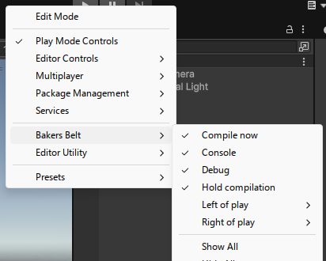

<p align="center">
  
</p>

<h3 align="center">The editor shortcuts you reach for most, on Unity's main toolbar, with room for your own.</h3>

## Install

Unity 6.3 (6000.3) or newer. The main toolbar API this is built on does not exist before that.

**In the Package Manager**

1. Open `Window > Package Manager`
2. Press **+**, then **Install package from git URL**
3. Paste this and press Add:

```
https://github.com/CookieJarTools/BakersBelt.git
```

**Or by hand**, put this line in `Packages/manifest.json`:

```json
"com.cookiejartools.bakersbelt": "https://github.com/CookieJarTools/BakersBelt.git"
```

<p align="center">
  
</p>

## What you get

**Hold compilation.** A padlock that keeps Unity from reloading the domain while you work through
a change that touches several files. Press it again to let go.

**Compile now.** Ask for a compile the moment you are ready for one. If the padlock is down it
lifts first, so the button never quietly does nothing.

**Debug.** Put every inspector into debug mode at once, and open the UI Toolkit debugger, without
going hunting through menus.

**Console.** Open the console, clear it, and reveal the folder your game actually writes to.

**Room for your own.** Six slots either side of the play controls, filled from your own editor code.

## Adding your own button

```csharp
using CookieJarTools.BakersBelt.Editor.Toolbar;

[InitializeOnLoad]
internal static class MyButtons
{
    static MyButtons()
    {
        BeltToolbar.AddIconButton("d_SaveAs", "Save everything", () => AssetDatabase.SaveAssets());

        BeltToolbar.AddDropdown("Scenes", "Jump to a scene", menu =>
            menu.AddItem(new GUIContent("Boot"), false, OpenBootScene));

        BeltToolbar.AddToggle("Slow", "Run at a tenth speed", false, on => Time.timeScale = on ? 0.1f : 1f);
    }
}
```

Every call takes `onTheRight: false` as a last argument if you would rather sit to the left of the
play controls. Icon names are the ones `EditorGUIUtility.IconContent` uses.

## Turning things on and off

A toolbar element installed by a package arrives switched off, and Unity gives packages no
supported way to change that. Bakers Belt turns its own four on once, the first time you install
it, and never touches them again, so anything you switch off stays off.

Everything is listed under **Bakers Belt** when you right click the main toolbar. Your own buttons
live under **Left of play** and **Right of play** in that same menu, one entry per slot.

<p align="center">
  
</p>

You can also drag any of them somewhere else along the toolbar with **Edit Mode** at the top of
that menu.

## A note on earlier versions

Up to 1.1.2 the belt reached into the editor's own visual tree and added whatever `VisualElement`
you handed it. Unity 6.3 replaced that with a real toolbar API, and from 2.0.0 the belt uses it.

The trade is that only the kinds Unity provides can go on the toolbar now: a button, a dropdown, a
toggle, a label and a slider. Arbitrary elements of your own are no longer possible for anybody,
because the one method that would draw them is internal to the editor. In exchange, your buttons
are drawn by Unity, so they match everything around them, they can be moved and hidden like any
other toolbar element, and they survive the next editor update.

If you were calling `ToolbarExtender.AddLeft` or `AddRight`, the replacements are the four
`BeltToolbar` calls above.

## Licence

Free to use, including in games you sell, under the PolyForm Shield License 1.0.0.
The one thing it does not allow is using it to make something that competes with the
tool itself. See [LICENSE.md](LICENSE.md).
