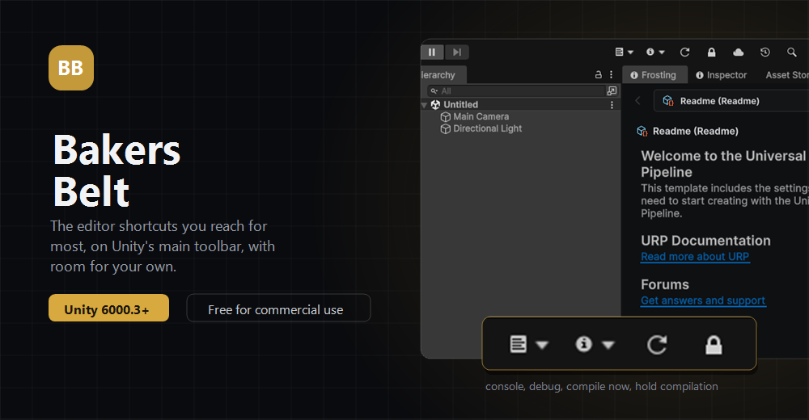

<p align="center">
  
</p>

<h3 align="center">Puts your own buttons on the Unity toolbar, with the ones you reach for most already there.</h3>

## Install

Unity 6000.0 or newer.

**In the Package Manager**

1. Open `Window > Package Manager`
2. Press **+**, then **Install package from git URL**
3. Paste this and press Add:

```
https://github.com/CookieJarTools/BakersBelt.git
```

**Or by hand**, put this line in `Packages/manifest.json`:

```json
"com.cookiejartools.bakersbelt": "https://github.com/CookieJarTools/BakersBelt.git"
```

<p align="center">
  
</p>

## What you get

**A toolbar extender.** Add any VisualElement to the Unity toolbar, left or right of the play
buttons, from your own editor code.

**Compile controls.** Turn Unity's auto compile off while you work through a big change, then force
a compile when you are ready for one.

**Debug tools.** Flip every inspector into debug mode, and open the UI Toolkit debugger, without
hunting through menus.

**Console shortcuts.** Open the console, clear it, and reveal the persistent data folder.

## Adding your own button

```csharp
ToolbarExtender.AddRight(new Button(() => Debug.Log("hello")) { text = "Hello" });
```

Call it from a class marked `[InitializeOnLoad]` and the button is there from the moment the
editor opens.

## Licence

Free for noncommercial use under the PolyForm Noncommercial License 1.0.0.
Commercial use needs a licence, so get in touch. See [LICENSE.md](LICENSE.md).
